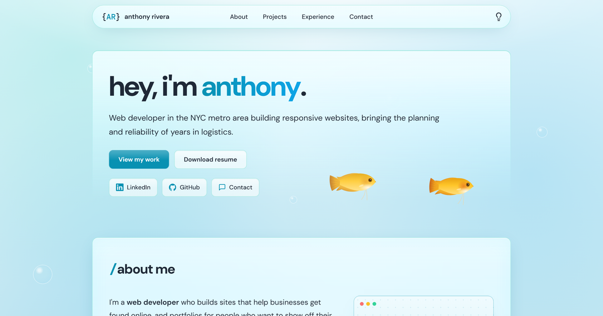

# anthonydanrivera.com

My personal portfolio site: who I am, what I've built and how to reach me.

**Live:** [anthonydanrivera.com](https://anthonydanrivera.com)



## What's on it

- **About:** a short intro, the tools I work with and what I do outside of code.
- **Projects:** client and personal work, starting with [Eros Pro Cleaning](https://erosprocleaning.com).
- **Experience and education.**
- **Light and dark mode,** saved between visits.
- **An ASCII fish tank** with two honey gouramis. Click the water in the side margins to drop food and they swim over to eat it.

## Built with

Plain HTML, CSS and JavaScript. There's no framework and no build step. The site is hosted on Netlify.

## Project layout

```
index.html          the whole site, one page
css/style.css       styles, theme colors and layout
js/main.js          theme toggle, nav and scroll reveals
js/gouramis.js      the fish: swimming, feeding and reactions
assets/             images, icons, social preview and resume
tests/              tests for the fish controller
robots.txt, sitemap.xml
```

## Running it locally

Open `index.html` in a browser, or serve the folder so paths resolve the same way they do in production:

```sh
npx serve .
# or
python -m http.server
```

## Tests

The gourami animation has tests that run on a simulated clock, so no browser is needed. They use Node's built-in test runner (Node 18+):

```sh
node --test tests/
```

## Contact

- Email: [anthonydanrivera@gmail.com](mailto:anthonydanrivera@gmail.com)
- LinkedIn: [linkedin.com/in/anthonydanrivera](https://www.linkedin.com/in/anthonydanrivera)
